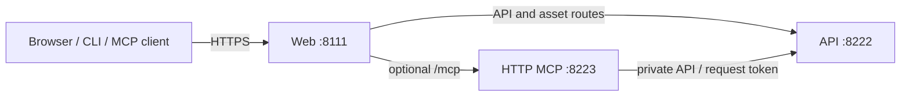

# Web gateway and one public origin

Web listens on 8111, API on 8222 and optional HTTP MCP on 8223 in the shipped
templates. Put the public HTTPS ingress in front of Web. Web uses container DNS
`http://api:8222/` and, when selected, `http://mcp-http:8223/`. Standalone/local
processes and split-host deployments supply explicit destinations. Resolution
does not scan addresses or change destinations during backend outages.



## Destination and origin ownership

`ApiBaseUrl` is resolved once for Web's API clients and the generated
`apiCluster` destination `api1`. Shipped local-process default is
`http://127.0.0.1:8222/`; source/release Compose chooses `http://api:8222/`.
An explicit advanced `ReverseProxy` cluster can intentionally differ from the
API-client target; startup diagnostics identify the divergence.

Public identity is separate from the private backend. Set deployment-owned
`WebGateway:PublicOrigin` to an HTTPS origin such as
`https://rateldesk.example.test`, and API
`IntegrationCredentials:Pairing:PublicOrigin` to that same instance origin.
Never derive approval or MCP resource URLs from incoming Host headers or private
container addresses. For a standalone/split MCP public resource, set
`WebGateway:Mcp:PublicResourceUri` explicitly. It is an HTTPS `/mcp` URL; when
PublicOrigin is omitted, its authority supplies the trusted public origin.
Both may be explicit for split-resource topology. Web does not rewrite the
HTTP host's resource metadata, so align it with `Helpdesk:Mcp:PublicResourceUri`.

## Supported routes

| Route identity | Public path | Behavior |
| --- | --- | --- |
| `api-v1-route` | `/api/v1/{**catch-all}` | API V1, including pairing and execution-token endpoints |
| `api-openapi-route` | `/api/openapi/{**catch-all}` | Remove `/api`; set forwarded prefix `/api` |
| `api-incidents-assets-route` | `/api/incidents/{**catch-all}` | Existing incident assets |
| `api-worklogs-assets-route` | `/api/worklogs/{**catch-all}` | Existing worklog assets |
| `api-email-template-assets-route` | `/api/email-templates/{**catch-all}` | Existing email-template assets |
| `api-tenant-branding-assets-route` | `/api/tenants/{**catch-all}` | Existing tenant assets |
| `email-brand-route` | `/email-brand/{**catch-all}` | Existing email branding |
| `mcpRoute` | `/mcp/{**catch-all}` | Optional MCP cluster; retain the `/mcp` prefix |
| `mcpMetadataRoute` | `/.well-known/oauth-protected-resource/mcp` | Generated only for explicit Authentik ingress |

Web owns `/api/docs`, its static UI assets, setup, account login and browser
approval pages. There is no generated unrestricted `/api` catch-all. Existing
service-link discovery/authorization/token routes retain their API ownership.
Gateway ingress does not advertise fabricated OAuth resource metadata.

## Options and environment equivalents

Use .NET double underscores for nested environment keys. These are environment
keys passed to the Web process, independent of Compose interpolation names.

| JSON key | Environment key | Default / condition |
| --- | --- | --- |
| `ApiBaseUrl` | `ApiBaseUrl` | Local default above; absolute HTTP(S) URL |
| `WebGateway:PublicOrigin` | `WebGateway__PublicOrigin` | Unset; HTTPS origin without path/query/fragment/credentials |
| `WebGateway:Mcp:Enabled` | `WebGateway__Mcp__Enabled` | `false`; selects generated MCP routes |
| `WebGateway:Mcp:Destination` | `WebGateway__Mcp__Destination` | Required when selected; HTTP(S) backend |
| `WebGateway:Mcp:PublicResourceUri` | `WebGateway__Mcp__PublicResourceUri` | Optional explicit HTTPS `/mcp` resource |
| `WebGateway:Mcp:AuthenticationMode` | `WebGateway__Mcp__AuthenticationMode` | `gateway`; also `authentik` |
| `WebGateway:Mcp:HardDisable` | `WebGateway__Mcp__HardDisable` | `false`; blocks MCP even through manual/broad routes |
| `WebGateway:Mcp:ActivityTimeout` | `WebGateway__Mcp__ActivityTimeout` | `00:05:00`; 1 second–24 hours |
| `WebGateway:RemoveRoutes` | `WebGateway__RemoveRoutes__0` etc. | Empty; explicit route identities to delete |
| `WebGateway:RemoveClusters` | `WebGateway__RemoveClusters__0` etc. | Empty; explicit cluster identities to delete |
| `WebGateway:TrustedProxies` | `WebGateway__TrustedProxies__0` etc. | IP-address allowlist |
| `WebGateway:TrustedNetworks` | `WebGateway__TrustedNetworks__0` etc. | CIDR allowlist |

MCP selection requires PublicOrigin or PublicResourceUri and a valid
Destination. Empty trusted-proxy lists retain the existing permissive forwarding
behavior for compatibility. Configure explicit proxy/network lists at production
ingress; those restrict trust to configured entries plus loopback. Linked OIDC
uses the processed forwarded values. Outer ingress must also preserve the correct
public scheme/host and accept only its intended upstream traffic.

```json
{
  "ApiBaseUrl": "http://api:8222/",
  "WebGateway": {
    "PublicOrigin": "https://rateldesk.example.test",
    "Mcp": {
      "Enabled": true,
      "Destination": "http://mcp-http:8223/",
      "AuthenticationMode": "gateway"
    }
  }
}
```

Selecting a Compose profile alone cannot change another service's environment.
Use an MCP overlay that explicitly enables Web's route and configures the HTTP
host; see [HTTP MCP deployment](../mcp-http/deployment.md).

## Overrides, deletion and reload

The gateway builds one effective YARP configuration: generated defaults first,
then explicit `ReverseProxy` values in .NET provider order. Route/cluster objects
merge by case-insensitive identity. Later values replace individual properties;
list/array properties, Transforms and a cluster's entire Destinations collection
replace the earlier collection. Distinct custom identities remain available.
Adding a later destination therefore replaces `api1` rather than creating an
accidental competing target. Do not define separate YARP providers and expect
partial objects to merge automatically.

Delete identities through `RemoveRoutes`/`RemoveClusters`; omitting a default
from an override does not delete it. `Enabled=false` disables generation and
preserves an existing manually configured MCP route. `HardDisable=true` blocks
reserved MCP paths regardless of custom catch-all routes.

For example, a shell-safe advanced destination override is
`ReverseProxy__Clusters__mcpCluster__Destinations__mcp1__Address`.
The Web image directly executes `dotnet`, preserving existing route IDs and
new `mcpRoute`/`mcpCluster` environment binding without shell reinterpretation.

`ApiBaseUrl` and `WebGateway` generated options are startup-only. Supported
explicit `ReverseProxy` file reload remains active: invalid candidates are
rejected and the previous working configuration remains. Environment changes
require process restart/container recreation; editing `.env` does not update a
running container.

## Transport and failure behavior

YARP preserves explicit Authorization and MCP Accept/content/protocol/session
headers and request methods. Web cookies/service tokens do not replace the
client's bearer. The generated MCP cluster disables response buffering and uses
the configured activity timeout. Configure the outer ingress for streaming,
appropriate idle/request timeouts and cancellation; a final buffered response
does not prove incremental streaming.

Unselected reserved MCP paths return a 404 JSON problem response. Hard-disabled
paths also stay unavailable. Selected but unavailable MCP remains routed and
returns the backend/proxy failure (normally 502/503), without Blazor HTML,
environment switching or credential fallback. Readiness and startup ordering
are separate from route selection.

Verify route reachability, mode-appropriate metadata, authentication,
`initialize` and one permitted read-only tool result separately using the
[verification guide](../mcp-http/troubleshooting.md). API docs, OpenAPI, assets,
setup/login, webhooks and NetRatel connections retain their existing behavior.
