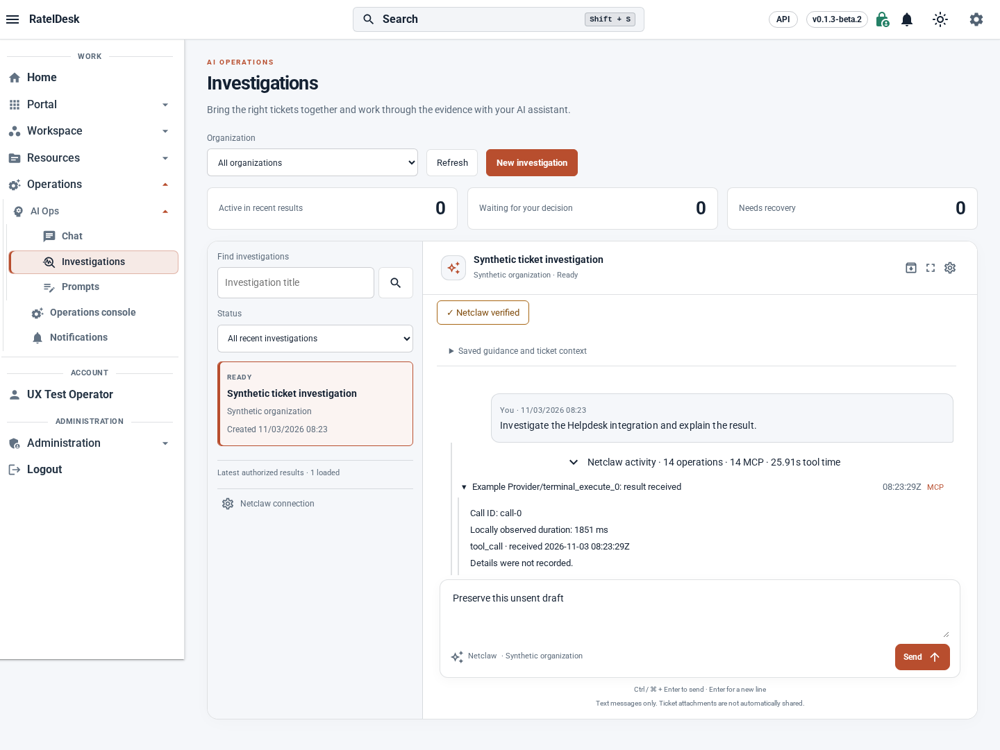
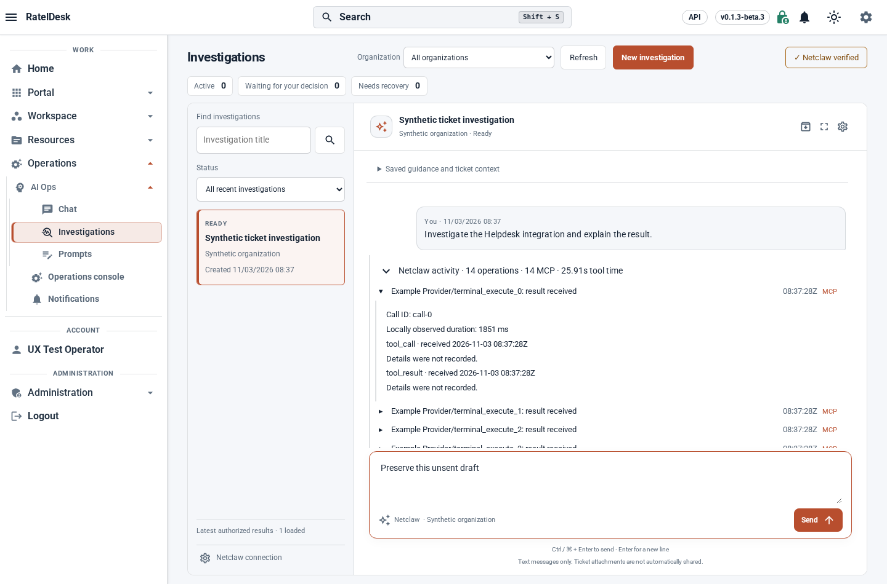
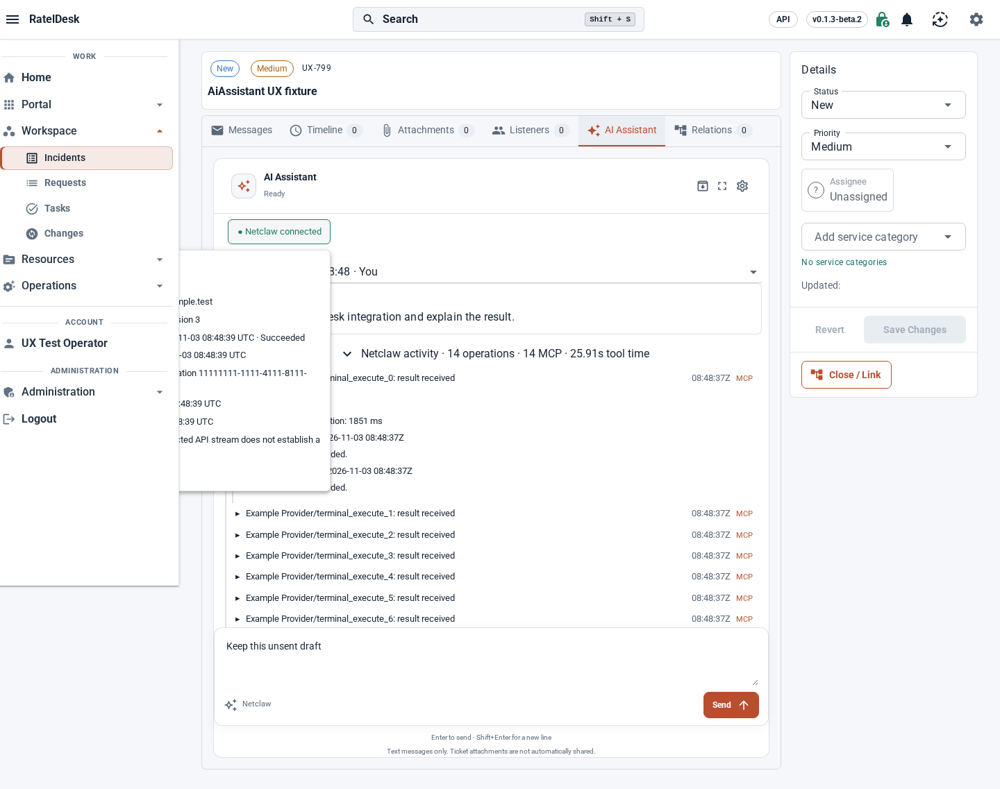
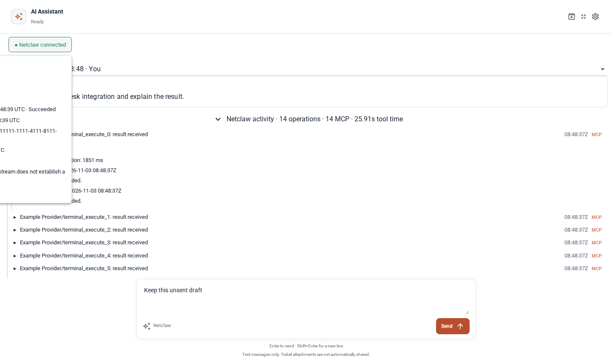
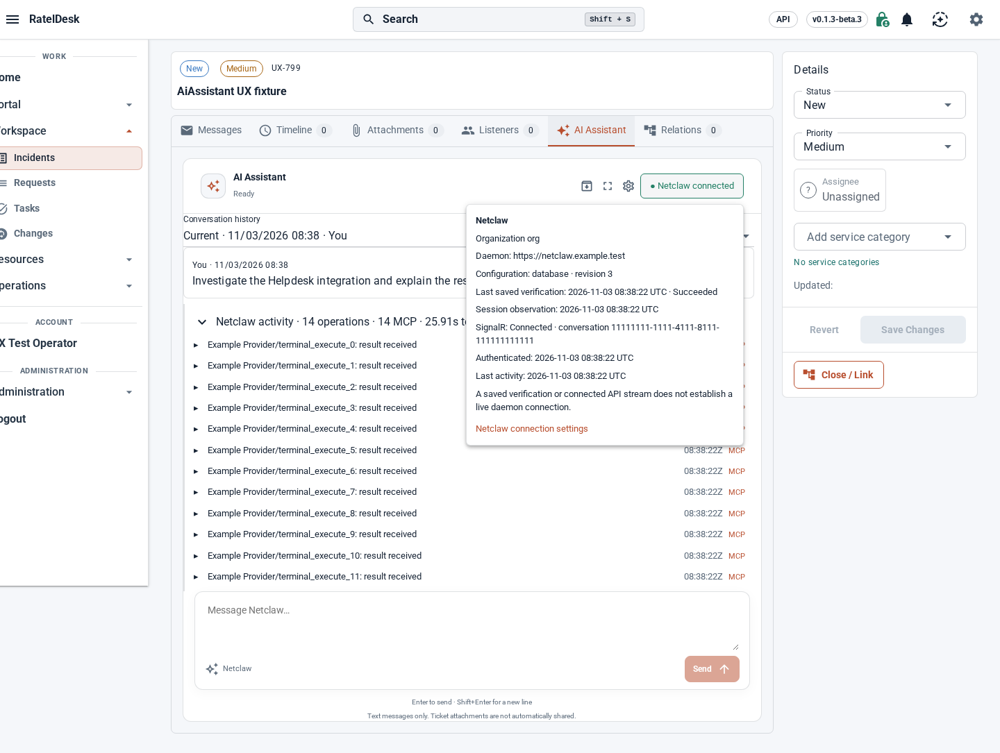
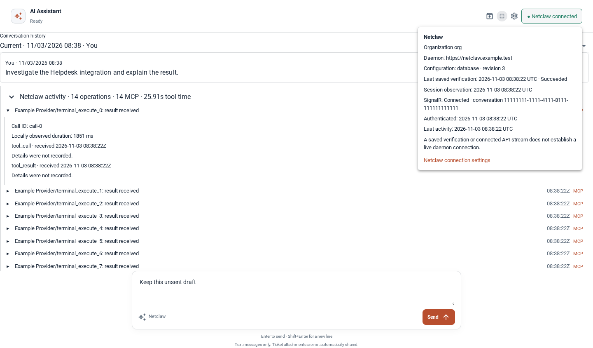

# 0.1.3-beta.3 AI workspace rendered evidence

Captured on 3 November 2026 using the actual NewWeb host and loopback-only
synthetic API. Organizations, tools, endpoint and operator data are fixtures.
These images establish rendered source behavior, not owner deployment or a
live Netclaw daemon result. The owner reference is described in
[#315](https://github.com/BostonTechnologies/RatelDesk/issues/315); private
reference screenshots and conversation contents are not copied here.

## Investigation comparison

Both matched captures use a 1440 × 950 browser viewport with the drawer open,
a selected investigation, fourteen mixed tool names, an expanded call and an
unsent draft. The before page overflows vertically; the after page gives the
list and conversation the remaining viewport height. The toolbar/counter stack
moves the workspace from approximately y=347 to y=167. The reference asks for
approximately y=181 at comparable desktop proportions, rather than a fixed
product pixel coordinate.

[Before beta.2](assets/ai-ux-beta3/investigations-before.png) ·
[After correction](assets/ai-ux-beta3/investigations-after.png)

The browser checks also measure 1912 × 914 and 1366 × 640 selected views:
workspace starts below the compact controls, counters stay below 45 CSS pixels,
the composer stays within the viewport and redundant page overflow is absent.
Empty, processing, approval, recovery and archived views retain their controls.
Very short/zoomed and narrow layouts allow page scrolling when controls need
more room. Fullscreen remains optional.

## Connection popup and tool rows

The normal incident capture retains the application drawer. The fullscreen
capture expands only the conversation. Both use a fresh synthetic Connected
observation, the green right-hand badge, inward-opening contained popup and
fourteen tools with short and long names.

The additional before captures are rendered from unmodified beta.2 source
`8efef5604d9387755cc410839a9744c5b1e19829` at the same 1440 × 844 viewport
and synthetic incident fixture. They reproduce the separate connection strip,
left-clipped popup and centered activity heading.

`ai-ux-corrections.spec.ts` checks all three surfaces at desktop and 390px,
compact/expanded rows, resize to 568px height, settings content growth and
native browser zoom at 200%. Popup bounds and hit testing prove containment
above the scrolling panes; row and label coordinates prove left alignment.
Drafts, expanded calls and stream counts survive presentation changes.

## Payload and regression evidence

`ChatTraceSafetyTests` compares exact plain text, Markdown, JSON, malformed
JSON, nested strings, emoji and large/deep results across extraction and JSON
serialization. Native transport/PostgreSQL tests read the persisted arguments,
results, names and source times from fresh database contexts. Existing
conversation authorization, approval ownership and late-output tests remain.
The browser compares displayed text and actual clipboard contents with the
fixture's received skill/discovery payloads before and after reload, including
a discovery result beyond the old truncation threshold and inert HTML text.

`ai-assistant-chat.spec.ts` exercises Stop cancellation and confirmation;
ordinary processing has no warning/acknowledgement panel. Existing AI parity
journeys preserve first-send identity, organization fences, recovery and
archive behavior. Final exact-source CI and publication receipts belong to the
PR/release; these screenshots alone do not establish those gates or deployed
owner acceptance. Historical exact-turn recovery remains tracked in #308.
