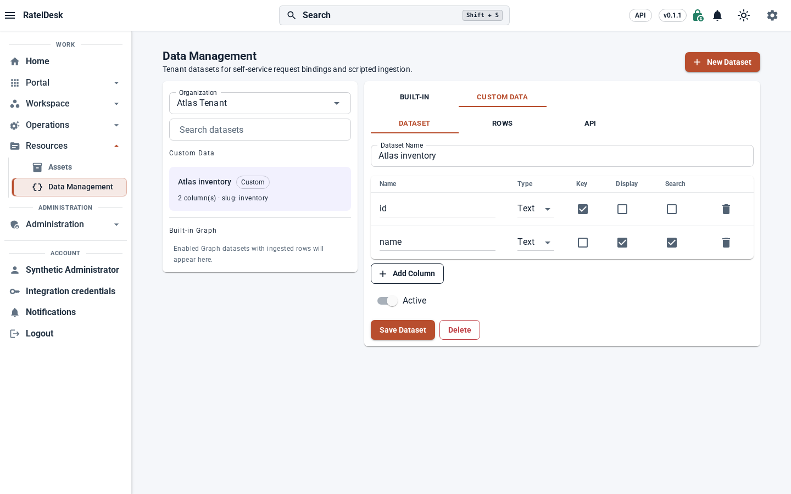
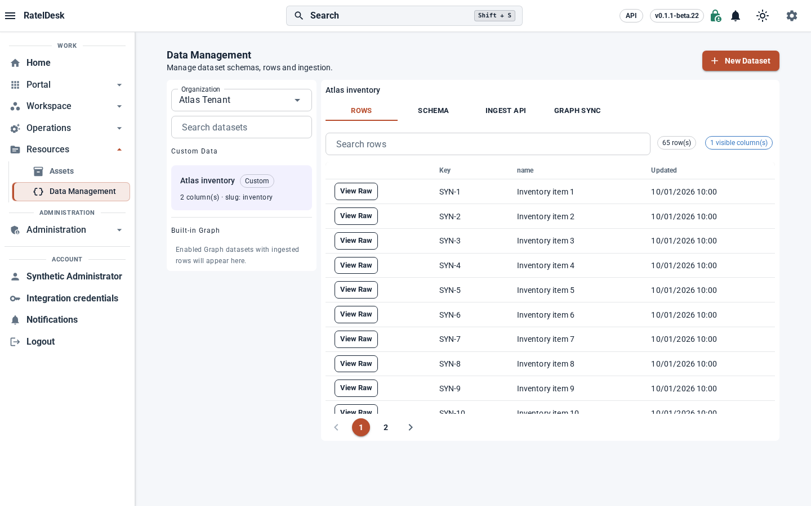
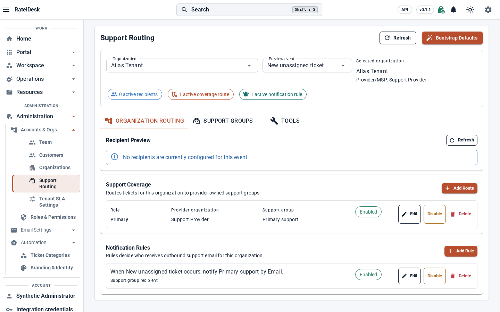
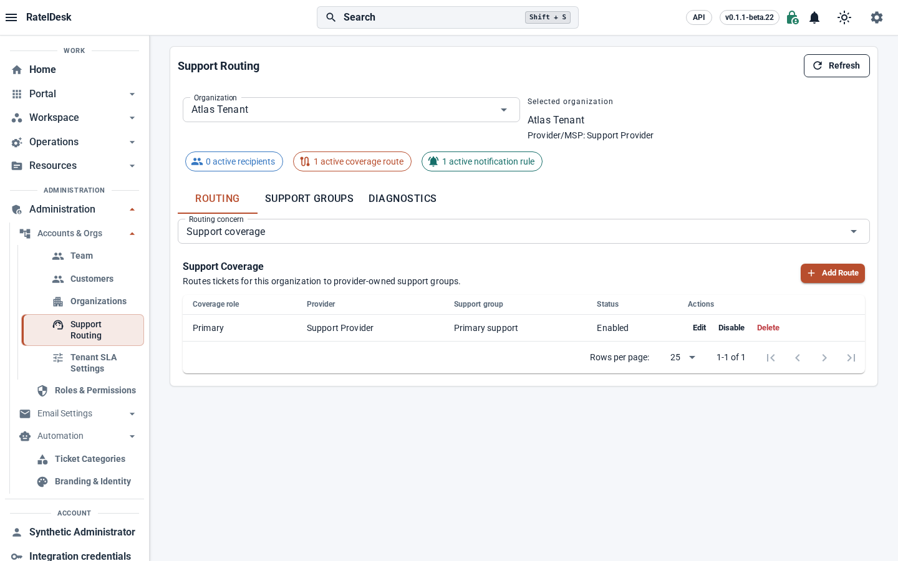
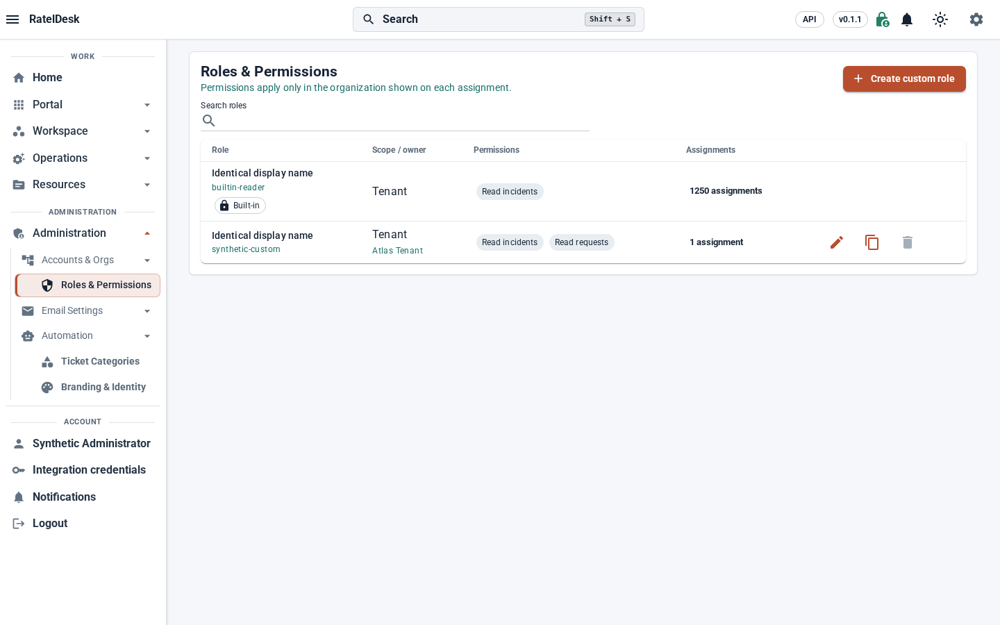
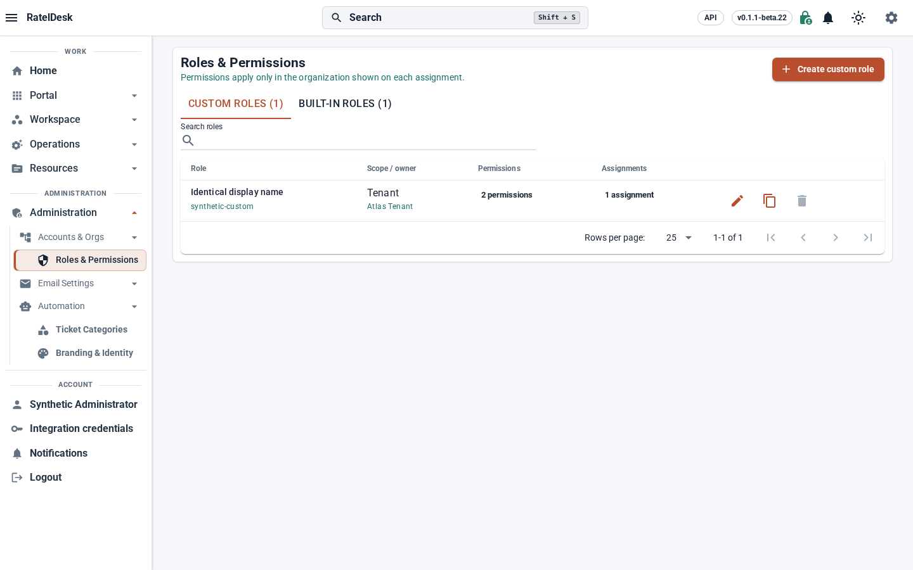
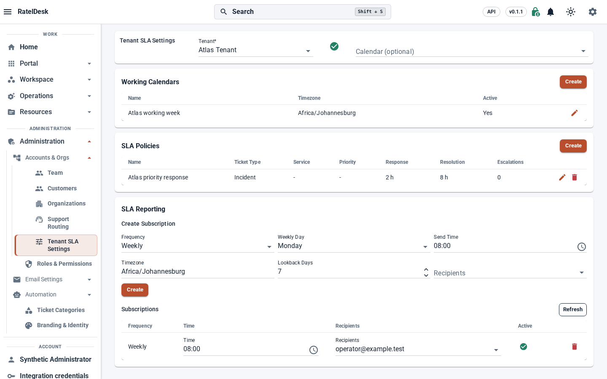
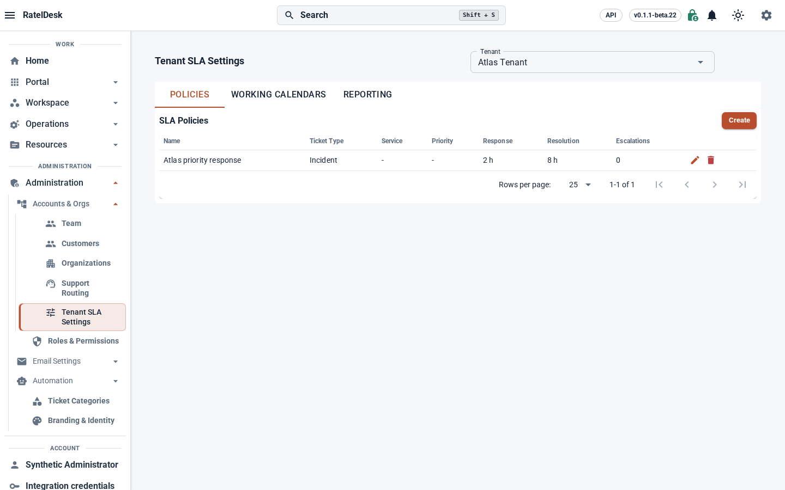
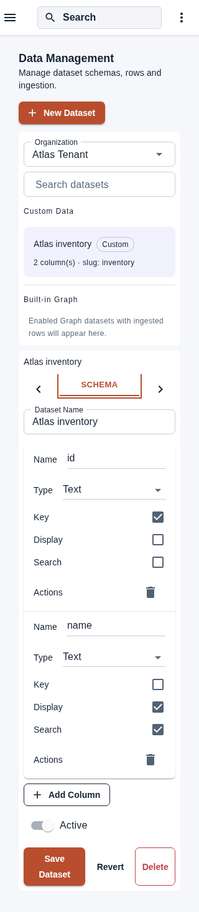

# Admin workspace evidence for 0.1.1

Captured 2026-10-15 for issues [#171](https://github.com/BostonTechnologies/rateldesk/issues/171), [#172](https://github.com/BostonTechnologies/rateldesk/issues/172), [#173](https://github.com/BostonTechnologies/rateldesk/issues/173) and [#174](https://github.com/BostonTechnologies/rateldesk/issues/174). Current usage is documented in the [administration workspaces guide](../deployment/admin-workspaces.md).

## Source and validation receipt

The before captures use the original UI at `origin/main` commit `4e3023c`, built in Release with only the shared version advanced to `0.1.1`. The after captures use the isolated `codex/workspace-admin` Debug worktree: final source change `38c06f6`, final fixture revision `ee767c2`. Its unchanged version file still displays **`v0.1.1-beta.22`**. The differing badges reflect separate build inputs; these captures are UI evidence, not proof of an integrated stable release or promotion.

| Check | Result |
| --- | --- |
| Pinned .NET SDK | `10.0.400` |
| Focused Web Debug build | Passed; **0 warnings, 0 errors**, 50.28 seconds |
| Admin browser suite | **14/14 passed**, 0 skipped, 0 flaky, 80.788 seconds |
| Responsive after captures | 32: four workspaces × light/dark × 320/768/1440/1920 pixels |
| Additional focused capture | Schema editor at 320 pixels; 33 valid after captures total |
| Before captures | Eight: four workspaces × light/dark at 1440 pixels |

The [Playwright configuration](../../playwright.admin.config.ts) launches real Blazor hosts with admin, delegated and read-only identities against a [synthetic loopback fixture](../../tests/ux/admin-fixture-api.mjs). The [browser cases](../../tests/ux/admin-workspaces.fixture.ts) cover keyboard tabs and complete selected-tab bounds at 320 pixels, accessible schema controls, role metadata and permission ceilings, paging/search, failed saves and Revert, dirty-context confirmation, stale responses, retained Graph/API-key drafts, report editing, explicit calendar saves and routing cancellation/toggle payloads. API authorization and SQLite/PostgreSQL persistence require the separate integrated provider checks.

```bash
dotnet build src/HelpDesk.NewWeb/HelpDesk.NewWeb.csproj -m:1 -nr:false --no-restore
npx playwright test --config playwright.admin.config.ts
```

All identities and records shown below are synthetic. No production Graph ingestion, report delivery or routing bootstrap was run. Native **200% browser zoom belongs to the separate release zoom suite**. An auxiliary CDP viewport/DPR capture was rejected after visual review and is excluded from this report and its assets.

## Matching desktop comparisons

Each pair uses the same synthetic records, light theme and 1440-pixel viewport. Images preserve their original full-page height; the shorter after views illustrate the task separation.

| Workspace | Before | After |
| --- | --- | --- |
| Data Management: schema/rows, ingestion and Graph configuration become focused tasks |  |  |
| Support Routing: coverage/rules, groups and diagnostics have separate tabs |  |  |
| Roles: Custom roles opens first; authoritative built-in roles have their own tab |  |  |
| Tenant SLA: policies, calendars and reporting share one tenant context |  |  |

## Narrow schema editor

At 320 pixels, the selected tab stays fully visible; schema rows expose field labels and accessible names for name, type, key, display, search and removal. Save, Revert and Delete remain reachable. This additional image is from the final passing keyboard/accessibility case.


